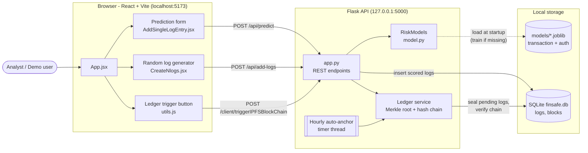
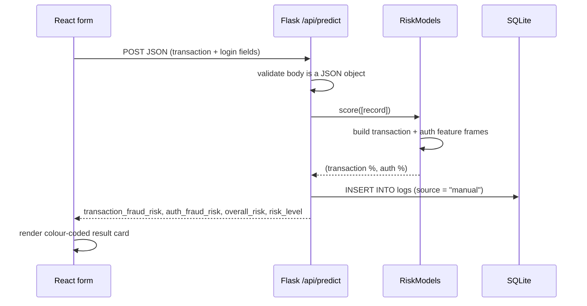
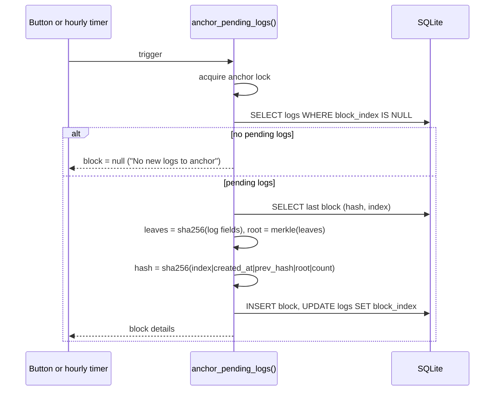
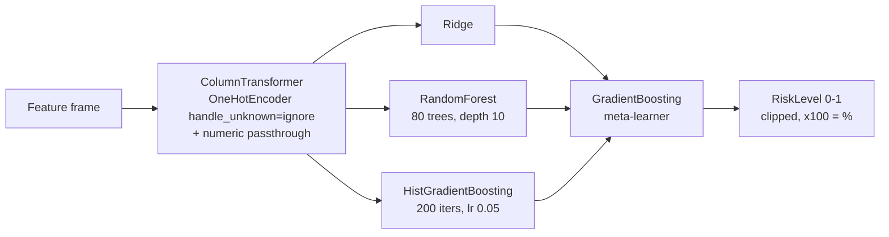
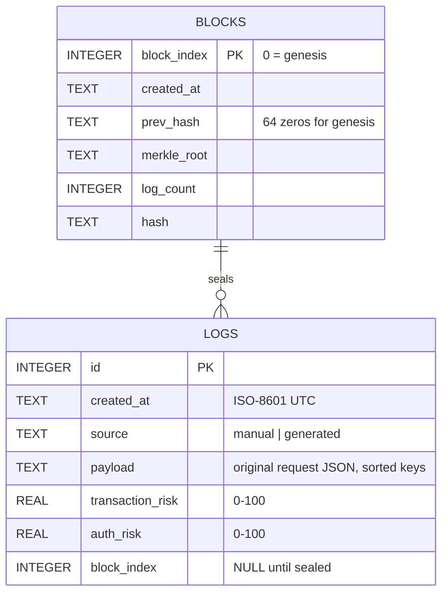

# FinSafe AI

Real-time fraud risk scoring for financial transactions **and** the logins behind them, with a tamper-evident audit ledger.

A transaction can look normal while the session that made it is not (unknown IP at 3 a.m., MFA off, five failed attempts). FinSafe AI scores both sides with two ML models, stores every decision, and seals the log history into a hash chain so that any later edit is detectable.

## Team

- Abhishek Gupta → https://github.com/AbhishekG160
- Meghna Malasi → https://github.com/Meghnagit20
- Vaibhav Gupta → https://github.com/Gupta2708
- Vijayshree → https://github.com/vijayshreepathak

## Contents

- [Features](#features)
- [Tech stack](#tech-stack)
- [Quick start](#quick-start)
- [Verify it works](#verify-it-works)
- [System architecture (HLD)](#system-architecture-hld)
- [Low-level design (LLD)](#low-level-design-lld)
- [API reference](#api-reference)
- [Configuration](#configuration)
- [Project structure](#project-structure)
- [Troubleshooting](#troubleshooting)
- [Limitations and roadmap](#limitations-and-roadmap)

## Features

| Feature | What it does |
| --- | --- |
| **Transaction risk** | Scores a transaction from amount, balances, currency, type, status and payment method. Strongest signals: balances that don't reconcile, amounts that drain the account, crypto payouts, failed/reversed transactions. |
| **Authentication risk** | Scores the login from failed attempts, MFA status, login hour, public vs private IP, device, OS/browser, API access and privilege level (admin without MFA is heavily penalised). |
| **Bulk log simulation** | Generates N realistic transaction + login events (about 25% with tampered balances), scores the whole batch in one call and stores it. |
| **Tamper-evident ledger** | Seals stored logs into SHA-256 hash-chained blocks with a Merkle root per block. Runs every hour automatically or on demand; `GET /api/ledger` re-verifies the entire chain and reports the first broken block. |

Each score is a percentage. Overall risk is the higher of the two: **Low** < 30% ≤ **Medium** < 60% ≤ **High**.

## Tech stack

| Layer | Technology |
| --- | --- |
| Frontend | React 18, Vite 4, Tailwind CSS 3, NextUI 2 |
| Backend | Python 3.9+, Flask, Flask-CORS |
| ML | scikit-learn (stacking ensemble), pandas, numpy, joblib |
| Storage | SQLite (single file, created automatically) |

## Quick start

**Prerequisites:** Node.js 18+ and Python 3.9+ (check with `node -v` and `python --version`).

### 1. Clone

```bash
git clone https://github.com/vijayshreepathak/FinSafe-Ai.git
cd FinSafe-Ai
```

### 2. Start the backend (terminal 1)

```bash
cd backend
pip install -r requirements.txt
python app.py
```

Wait for `Running on http://127.0.0.1:5000`. Trained models are included in `backend/models/`; if they can't be loaded (missing, or saved by a different scikit-learn version), the server retrains them automatically on first start, which takes about 20 seconds.

Optional, to keep dependencies isolated:

```bash
python -m venv .venv
# Windows: .venv\Scripts\activate     macOS/Linux: source .venv/bin/activate
pip install -r requirements.txt
```

### 3. Start the frontend (terminal 2, from the project root)

```bash
npm install
npm run dev
```

Open **http://localhost:5173**. Keep both terminals running: the UI needs the backend for every action.

### Production build (optional)

```bash
npm run build      # outputs to dist/
npm run preview    # serves the build on http://localhost:4173
```

## Verify it works

1. **Backend health:** open http://127.0.0.1:5000/api/health → `{"status":"ok"}`.
2. **Low-risk prediction:** in the top form enter amount `200`, old balance `10000`, new balance `9800`, Purchase / Success / UPI, IP `192.168.1.5`, a daytime login, `0` failed attempts, Mobile, MFA Enabled, API No, User. Submit → both scores around **5%, Low**.
3. **High-risk prediction:** refresh, then enter `9500` / `10000` / `7000` (balance doesn't add up), Transfer / Reversed / Crypto, IP `45.33.12.9`, a login around 3 AM, `5` failed attempts, ATM, MFA Disabled, API Yes, Admin. Submit → transaction risk about **76%**, auth risk about **90%**, **High**.
4. **Bulk logs:** in *Add Random Logs* enter `20`, pick a location, click **Generate 20 Logs**, then **Add 20 Logs to Database** → a success popup and a *Risk Scores* table with a mix of Low/Medium/High. Stored logs are visible at http://127.0.0.1:5000/api/logs?limit=5.
5. **Ledger:** click **Manually Trigger Adding Logs to IPFS** → popup with block number, Merkle root and block hash. Click again → "No new logs to anchor". http://127.0.0.1:5000/api/ledger shows `"chain_valid": true`.
6. **Tamper detection:** from `backend/`, edit a stored log directly:

   ```bash
   python -c "import sqlite3; c=sqlite3.connect('finsafe.db'); c.execute('UPDATE logs SET transaction_risk=1 WHERE id=1'); c.commit()"
   ```

   Refresh `/api/ledger` → `"chain_valid": false` and `broken_at` names the altered block. To reset, stop the backend, delete `backend/finsafe.db` and start it again.

## System architecture (HLD)



**Components**

| Component | Responsibility |
| --- | --- |
| React client | Collects transaction + login data, generates synthetic traffic, displays scores, triggers ledger sealing. Holds no business logic beyond input handling. |
| Flask API | Validates requests, calls the models, persists every scored log, exposes the ledger. Stateless apart from SQLite, so it can run as a single process. |
| RiskModels | Loads two scikit-learn pipelines once at startup and scores batches of records in a single vectorised call. Retrains from synthetic data if the model files can't be loaded. |
| Ledger service | Groups un-sealed logs into a block: per-log SHA-256 leaves, a Merkle root, and a hash linking to the previous block. Verification recomputes everything from the stored rows. |
| Auto-anchor | Daemon timer thread that seals pending logs every `ANCHOR_INTERVAL_SECONDS` (default 1 hour). |
| SQLite | `logs` (every scored record) and `blocks` (the chain). Created automatically on first run. |

**Request flow: single prediction**



**Request flow: sealing the ledger**



## Low-level design (LLD)

### Frontend modules

| File | Responsibility |
| --- | --- |
| `src/main.jsx` | Mounts `<App />` inside `NextUIProvider`. |
| `src/App.jsx` | Page layout: prediction form, random-log generator, ledger trigger button. |
| `src/components/AddSingleLogEntry.jsx` | Form with 18 fields. `bind(name)` wires each Input/Select to state. On submit: `POST /api/predict`, loading state, error box if the backend is unreachable, colour-coded result card. |
| `src/components/CreateNlogs.jsx` | Generates `count` logs (capped at 1000) via `generateRandomLog`, sends them to `POST /api/add-logs`, shows per-log scores. "Add" stays disabled until logs exist. |
| `src/utils.js` | `API_BASE_URL` / `BACKEND_BASE_URL` from env, `generateRandomLog()` (balances reconcile in ~75% of logs), `addLogsToIPFSandBlockchain()` for the ledger button, random helpers. |
| `src/data.js` | Static option lists (camp locations etc.). |

### Backend modules

| File | Key functions |
| --- | --- |
| `backend/app.py` | Routes; `init_db()`, `store_logs()`, `anchor_pending_logs()`, `verify_chain()`, `merkle_root()`, `schedule_auto_anchor()`. |
| `backend/model.py` | `transaction_features()`, `auth_features()`, synthetic data generators, `_stacking_pipeline()`, `train()`, `RiskModels.score()`. Run `python model.py` to retrain. |

### Feature engineering

Input values are coerced defensively: empty or non-numeric numbers become 0, missing categoricals become `"Unknown"`, unparseable timestamps fall back to the current time, and malformed IPs are treated as public.

**Transaction model**

| Feature | Derivation |
| --- | --- |
| `TransactionAmount`, `OldBalanceOrig`, `NewBalanceOrig` | Raw numeric inputs |
| `BalanceError` | `|OldBalanceOrig ± TransactionAmount − NewBalanceOrig|` (+ for Deposit, − otherwise) |
| `AmountToBalance` | `TransactionAmount / (OldBalanceOrig + 1)` |
| `CurrencyType`, `TransactionType`, `TransactionStatus`, `PaymentMethod` | One-hot encoded |

**Authentication model**

| Feature | Derivation |
| --- | --- |
| `FailedLoginAttempts` | Raw numeric input (default 0) |
| `LoginHour`, `LoginWeekday` | Parsed from `LoginTimestamp` |
| `IsPublicIP` | 0 for private/loopback IPs, 1 otherwise |
| `DeviceType`, `OS_BrowserInfo`, `MFAStatus`, `APIAccess`, `PrivilegedAccess` | One-hot encoded |

### Model pipeline



- Same stacking design as the research notebooks (linear + random forest + boosted trees, blended by a gradient-boosting meta-learner), using scikit-learn-only estimators so there is no xgboost/lightgbm install risk.
- `OneHotEncoder(handle_unknown="ignore")` lives inside the pipeline, so unseen categories at inference time are safe. (The notebooks refit a `LabelEncoder` on each single input row, which maps every category to 0.)
- Training: 6,000 synthetic rows per model, seed 42, 80/20 split. Held-out R²: **0.98** (transaction), **0.96** (auth).

### Database schema (SQLite)



### Ledger algorithm

```text
leaf(log)      = SHA256(id | created_at | payload | transaction_risk | auth_risk)
merkle(leaves) = pairwise SHA256(left + right) up to one root; an odd node is paired with itself
block.hash     = SHA256(block_index | created_at | prev_hash | merkle_root | log_count)

verify_chain():  for each block in order
                   recompute the Merkle root from the block's stored logs
                   check prev_hash, merkle_root, log_count and hash
                   on the first mismatch -> chain_valid = false, broken_at = block_index
```

Changing any stored field of a sealed log (or deleting it) changes its leaf, so the block's Merkle root, its hash and every later link stop matching. A `threading.Lock` prevents the hourly timer and a manual trigger from sealing the same logs twice.

## API reference

Base URL: `http://127.0.0.1:5000`. All bodies are JSON. Errors return HTTP 400 with `{"error": "..."}`.

| Method | Path | Body | Response |
| --- | --- | --- | --- |
| GET | `/api/health` | – | `{"status": "ok"}` |
| POST | `/api/predict` | One flat object with the transaction + login fields | `{message, transaction_fraud_risk, auth_fraud_risk, overall_risk, risk_level}` |
| POST | `/api/add-logs` | `{"logs": [ {...}, ... ]}` (1–5000 objects) | `{message, count, high_risk_count, results: [{TransactionID, transaction_fraud_risk, auth_fraud_risk, risk_level}]}` |
| GET | `/api/logs?limit=50` | – | Latest logs (max 500) with payload, scores and `block_index` |
| GET | `/api/ledger` | – | `{blocks, pending_logs, chain_valid, broken_at}` |
| POST | `/client/triggerIPFSBlockChain` | – | `{message, block}`; `block` is `null` when nothing is pending |

Example:

```bash
curl -X POST http://127.0.0.1:5000/api/predict \
  -H "Content-Type: application/json" \
  -d '{"TransactionAmount":9500,"OldBalanceOrig":10000,"NewBalanceOrig":7000,"TransactionType":"Transfer","TransactionStatus":"Reversed","PaymentMethod":"Crypto","IPAddress":"45.33.12.9","LoginTimestamp":"2025-03-01T03:10","FailedLoginAttempts":5,"DeviceType":"ATM","MFAStatus":"Disabled","APIAccess":"Yes","PrivilegedAccess":"Admin"}'
```

**Accepted field values** (anything else is accepted and treated as unseen):

| Field | Values |
| --- | --- |
| `CurrencyType` | USD, EUR, INR, GBP, JPY |
| `TransactionType` | Deposit, Withdrawal, Transfer, Purchase |
| `TransactionStatus` | Success, Failed, Pending, Reversed |
| `PaymentMethod` | Credit Card, Debit Card, Wallet, UPI, Net Banking, Crypto, PayPal |
| `DeviceType` | PC, Mobile, Tablet, ATM, POS |
| `OS_BrowserInfo` | Windows, MacOS, Linux, iOS, Android |
| `MFAStatus` | Enabled, Disabled |
| `APIAccess` | Yes, No |
| `PrivilegedAccess` | Admin, User, Guest |

## Configuration

**Frontend** (`.env` in the project root; restart `npm run dev` after editing)

| Variable | Default | Purpose |
| --- | --- | --- |
| `VITE_API_BASE_URL` | `http://127.0.0.1:5000` | Backend base URL for `/api/*` |
| `VITE_BACKEND_BASE_URL` | `http://127.0.0.1:5000/client` | Base URL for the ledger trigger |

**Backend** (environment variables)

| Variable | Default | Purpose |
| --- | --- | --- |
| `PORT` | `5000` | Port the API listens on |
| `FINSAFE_DB` | `backend/finsafe.db` | SQLite file path |
| `ANCHOR_INTERVAL_SECONDS` | `3600` | Auto-seal interval |

## Project structure

```text
FinSafe-Ai/
├── backend/
│   ├── app.py                  # Flask API, SQLite, ledger, auto-anchor timer
│   ├── model.py                # features, synthetic training data, models
│   ├── models/                 # trained pipelines (auto-retrained if unusable)
│   │   ├── transaction_model.joblib
│   │   └── auth_model.joblib
│   └── requirements.txt
├── src/
│   ├── App.jsx
│   ├── main.jsx
│   ├── utils.js                # API config, random log generator, ledger call
│   ├── data.js
│   └── components/
│       ├── AddSingleLogEntry.jsx   # prediction form
│       └── CreateNlogs.jsx         # bulk log generator
├── .env                        # frontend API URLs
├── package.json
└── vite.config.js
```

## Troubleshooting

| Symptom | Fix |
| --- | --- |
| UI shows "Prediction failed … Is the backend running?" | Start the backend (`cd backend && python app.py`) and check http://127.0.0.1:5000/api/health. |
| `Port 5173 is in use` | An old dev server is still running. Close it (or stop the `node` process) and rerun `npm run dev`. |
| `Address already in use` on port 5000 (common on macOS because of AirPlay Receiver) | Run `PORT=5001 python app.py` and set both URLs in `.env` to port 5001. |
| `npm install` fails with `ERESOLVE` | Make sure you have the latest `package.json` / `package-lock.json` from this repo, then delete `node_modules` and retry. |
| Backend prints "Could not load saved models … training them now" | Expected after a scikit-learn version change. Wait about 20 seconds; the new models are saved for next time. |
| `python` not found on macOS/Linux | Use `python3` and `pip3`. |
| Want a clean demo state | Stop the backend, delete `backend/finsafe.db`, start it again. |

## Limitations and roadmap

- **Training data:** the original Kaggle datasets used in the research notebooks (in the [team fork](https://github.com/AbhishekG160/FinSafe-Ai)) are not bundled, so the shipped models are trained on synthetic data with the same features, labelled with standard fraud heuristics. Swapping in real data only requires changing the data source in `train()` in `backend/model.py`.
- **Ledger:** the hash chain is stored locally in SQLite. Next step: publish each block hash to IPFS and a public chain for external verifiability.
- **Explainability:** add per-prediction feature attributions (e.g. SHAP) so analysts see *why* a record was flagged.
- **Security:** the API has no authentication and allows all CORS origins; it is intended for local demos only.
